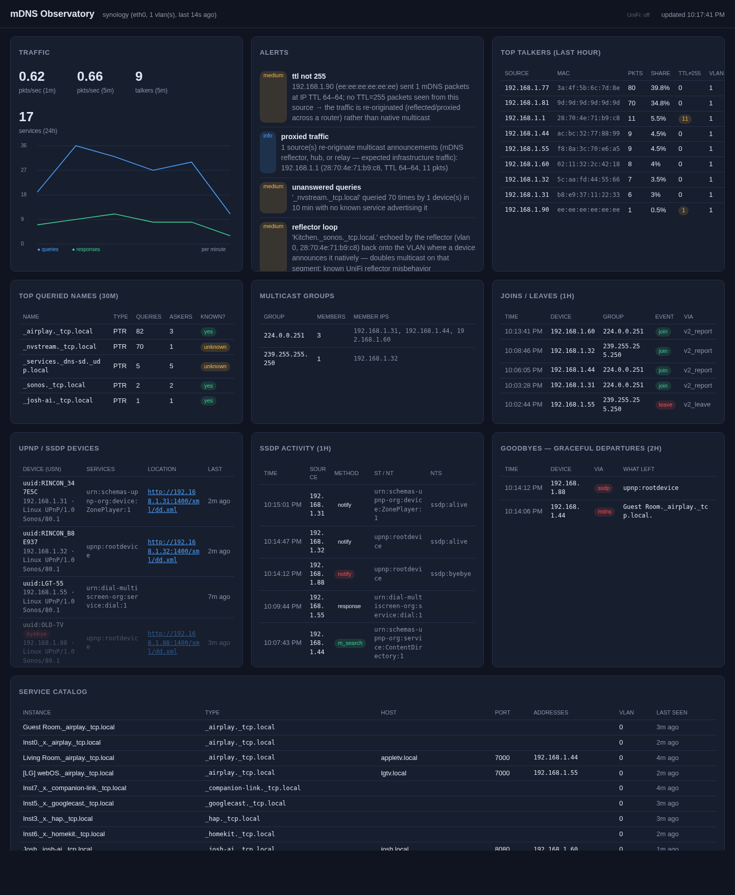

# mDNS Observatory

Passive mDNS/DNS-SD observability for multi-VLAN networks: capture sensors per
VLAN ship parsed mDNS traffic to a central collector, which serves a live
dashboard of packet rates, talkers, the service catalog, unanswered queries,
and health alerts (chatty devices, non-255 TTL → reflected/proxied traffic).

Built for UniFi deployments with heavy mDNS device fleets (Sonos, Apple TV,
smart TVs, Josh.ai).



## Architecture

```
┌─────────────┐  HTTP   ┌───────────────┐
│ sensor      │───────→ │ collector     │
│ (per VLAN)  │ JSON    │  SQLite + API │
│ AF_PACKET   │         │  :8053        │
└─────────────┘         └──────┬────────┘
                               └──→ dashboard (browser)
```

- **sensor** — raw-socket capture of UDP/5353, parses with dnslib, batches to
  the collector every 2s. Runs with `network_mode: host` so it sees all
  multicast on the host LAN. Docker on x86 Synology works as-is.
- **collector** — FastAPI + SQLite. Ingest, retention (72h default), service
  catalog state, alerting rules, dashboard UI on port 8053.

## Deploy on Synology (Container Manager / Docker)

**Zero-clone deploy** — grab `deploy/docker-compose.yml`, then:

1. If the GHCR packages are public, skip this. Otherwise, one-time:
   `docker login ghcr.io -u <github-user>` with a PAT (`read:packages` scope)
   so the NAS can pull the private images.
2. Find the interface carrying your primary VLAN: `ip link` on the NAS —
   commonly `eth0`, or `ovs_eth0` when bonded/Open vSwitch. Set it as
   `INTERFACE` in the compose file.
3. `docker compose up -d`
4. Open `http://<synology-ip>:8053`.

Images are built and published to GHCR automatically on every push to `main`
(`.github/workflows/build-images.yml`).

**Dev/local build** — the root `docker-compose.yml` pulls published images by
default; uncomment the `build:` lines to build from source instead
(`docker compose up -d --build`). `deploy/docker-compose.yml` is an identical
standalone copy for hosts that never clone the repo.

The sensor only sees traffic on the VLAN(s) its interface is on. For the other
VLANs later, either create VLAN subinterfaces on the NAS (`eth0.20` etc.) and
run one sensor per interface, or move sensors to a mirror/monitor port on a
switch configured as a trunk.

### On UniFi itself

UDM Pro/Max runs UniFi OS with Docker available — a sensor can run directly on
the gateway, where every VLAN bridge (`br0`, `br20`, …) is visible:

```
INTERFACE=br20 COLLECTOR_URL=http://<collector>:8053 docker run --net=host ...
```

## What the dashboard shows

- **Rates** — mDNS packets/sec now and trend (queries vs responses/min).
- **Top talkers** — devices generating the most mDNS traffic, annotated with
  UniFi client names/AP when enrichment is on. Devices sending with IP
  TTL ≠ 255 are flagged — routed/re-originated rather than native multicast.
- **Service catalog** — every advertised instance (`_airplay._tcp`, `_sonos._tcp`,
  …) with host, port, addresses, VLAN, last-seen. Rows show **stale** when a
  record ages past its TTL (device vanished) and **goodbye** when it left
  gracefully — the "shut off politely vs. crashed" distinction.
- **Top queried names** — what devices are looking for; "unknown" marks queries
  no service answers (classic discovery-failure symptom).
- **Multicast groups** — live estimate of who belongs to 224.0.0.251,
  239.255.255.250 and other groups, per VLAN — from IGMP/MLD reports.
- **Joins / leaves** — IGMP+MLD membership feed (join, leave, query).
- **UPnP / SSDP devices** — per-USN catalog: every service type each device
  advertises, description URL, server string, Sonos `X-RINCON` household IDs,
  and whether it sent `ssdp:byebye`.
- **SSDP activity** — M-SEARCH, NOTIFY, and response feed — "did the
  controller's search get answered?"
- **Goodbyes** — graceful departures: mDNS TTL=0 records and `ssdp:byebye`.
- **Alerts** — chatty devices (>5 pps), name conflicts (two devices claiming
  one instance, with each claimant's IP/MAC/VLAN), reflector loops (proxy
  echoing onto the origin VLAN), proxied/re-originated traffic summaries,
  unanswered query storms, and TTL anomalies with native-vs-reflected
  correlation.
- **Activity** — live packet feed.
- **UniFi status pill** — header shows enrichment health: client count and
  poll age, or the concrete error when it can't reach the controller.

## Local demo (no real LAN needed)

```
pip install dnslib
python3 collector/app.py &          # collector on :8053, DB in /data or ./data
INTERFACE=eth0 COLLECTOR_URL=http://127.0.0.1:8053 python3 sensor/sensor.py &
python3 tools/simulator.py --rate 3 # synthetic Sonos/ATV/Josh traffic
# open http://localhost:8053
```

Set `DB_PATH=/tmp/mdns.db` to keep the demo DB out of the way.

## Security notes

- **No TLS** — sensor→collector traffic and the dashboard are plain HTTP. This
  is designed for a trusted LAN. If you expose the collector beyond the LAN,
  put it behind a reverse proxy with TLS and auth.
- **Dashboard/API has no auth** — anyone on the network can read the dashboard
  and query the API. The data is mDNS metadata only (device names, service
  types), but treat port 8053 as LAN-only. Firewall it or bind behind a proxy
  if that matters to you.
- **Ingest auth is optional** — set `SENSOR_TOKEN` on both collector and
  sensors to require an `X-Sensor-Token` header on `/api/events`. Unset = open
  ingest (fine on a trusted LAN).
- **Sensor privileges** — needs `network_mode: host` and `NET_RAW` to sniff.
  It only reads packets; it transmits nothing except HTTP to the collector.
- **Collector runs non-root** inside its container (uid 1000).

## What it captures

- **mDNS** (UDP 5353, IPv4+IPv6): queries, responses, service announcements
- **IGMP/MLD** (IP proto 2 / ICMPv6): membership reports, leaves, and queries —
  the "who joined/left a multicast group" feed, including v2/v3 group records
- **SSDP/UPnP** (UDP 1900 multicast + unicast, plus Sonos broadcast 1900/6969):
  M-SEARCH, NOTIFY alive/byebye, and unicast responses — device catalog keyed
  by USN, with Sonos `X-RINCON` household IDs
- **Goodbyes**: mDNS TTL=0 records and `ssdp:byebye` — graceful departures vs.
  devices that vanish silently (shown stale after their records age out)

## Config

| Var | Component | Default | Purpose |
|---|---|---|---|
| `COLLECTOR_URL` | sensor | — | where to POST events |
| `INTERFACE` | sensor | — | interface to sniff |
| `SENSOR_ID` | sensor | hostname | label in dashboard |
| `SENSOR_TOKEN` | both | unset | shared secret for ingest auth (`X-Sensor-Token` header) |
| `BATCH_SECONDS` / `BATCH_MAX` | sensor | 2 / 500 | flush tuning |
| `CHATTY_PPS` | collector | 5 | pps threshold for chatty alert |
| `RETENTION_HOURS` | collector | 72 | packet/question/answer retention |
| `DB_PATH` | collector | /data/mdns.db | SQLite location |
| `UNIFI_HOST` | collector | – | e.g. `https://192.168.1.1` — enables UniFi enrichment |
| `UNIFI_API_KEY` | collector | – | Integrations-page API key → Integration API (recent firmware) |
| `UNIFI_USER` / `UNIFI_PASS` | collector | – | local account login → classic API (any firmware) |
| `UNIFI_SITE` | collector | default | controller site name |
| `UNIFI_POLL_SECONDS` | collector | 60 | how often to refresh the client list |

UniFi enrichment is optional. With credentials set, the collector polls the
controller and labels talkers, group members, UPnP devices and goodbyes with
each client's UniFi name and AP/switch — and a status pill in the dashboard
header shows whether the poll is working. Two auth modes, tried in order:

- `UNIFI_API_KEY` — keys from Settings → Control Plane → Integrations. These
  authenticate the official Integration API
  (`/proxy/network/integration/v1/`); the same key is also tried against the
  classic `stat/sta` endpoint. Needs recent UniFi OS/Network app.
- `UNIFI_USER` / `UNIFI_PASS` — a local (non-MFA) controller account logs in
  and the classic API is used. Works on every firmware; a "View only" local
  admin is enough.

Without credentials everything still works, just unlabeled.

## Testing

`tests/` has parser unit tests (`python -m pytest tests/`).
`docs/TESTING.md` is a full verification plan — lab checks plus real-network
procedures for Sonos/IoT discovery problems (missing speakers, unanswered
M-SEARCHes, graceful-vs-crash departures, IGMP membership flaps).

## API

`/api/summary` · `/api/timeseries` · `/api/talkers` · `/api/services` ·
`/api/questions` · `/api/activity` · `/api/igmp` · `/api/memberships` ·
`/api/ssdp` · `/api/upnp` · `/api/goodbyes` · `/api/alerts` ·
`/api/reflectors` · `/api/unifi` · `POST /api/events` (sensor ingest)

## Project layout

```
sensor/sensor.py            AF_PACKET capture + parsers (mDNS/IGMP/MLD/SSDP)
collector/app.py            FastAPI + SQLite: ingest, retention, API, alerts
collector/unifi.py          UniFi controller enrichment client
collector/static/index.html dashboard (no build step, no CDN)
tools/simulator.py          synthetic traffic generator for demos/tests
tests/                      parser unit tests
deploy/docker-compose.yml   standalone pull-only deploy file
```

## Roadmap hooks

- Propagation matrix: correlate service announcements across VLAN sensors to
  verify the UniFi mDNS proxy reflects each service (the same-VLAN
  reflector_loop case already alerts).
- UniFi per-port multicast counters to spot flooding vs. IGMP-snooping
  confinement (enrichment already pulls client names/AP/port).
- Query↔response correlation: "device X asked for Y and never saw an answer."
